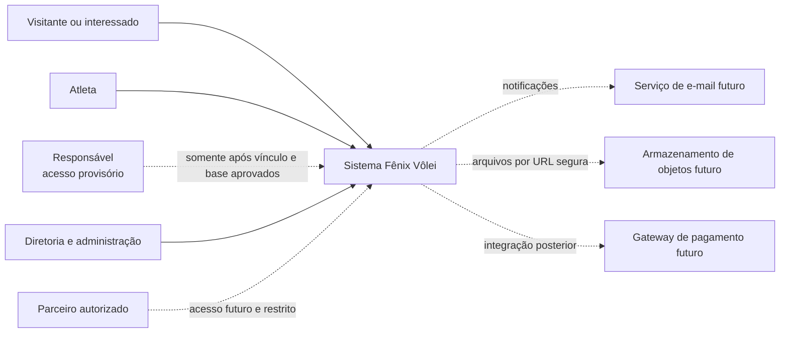
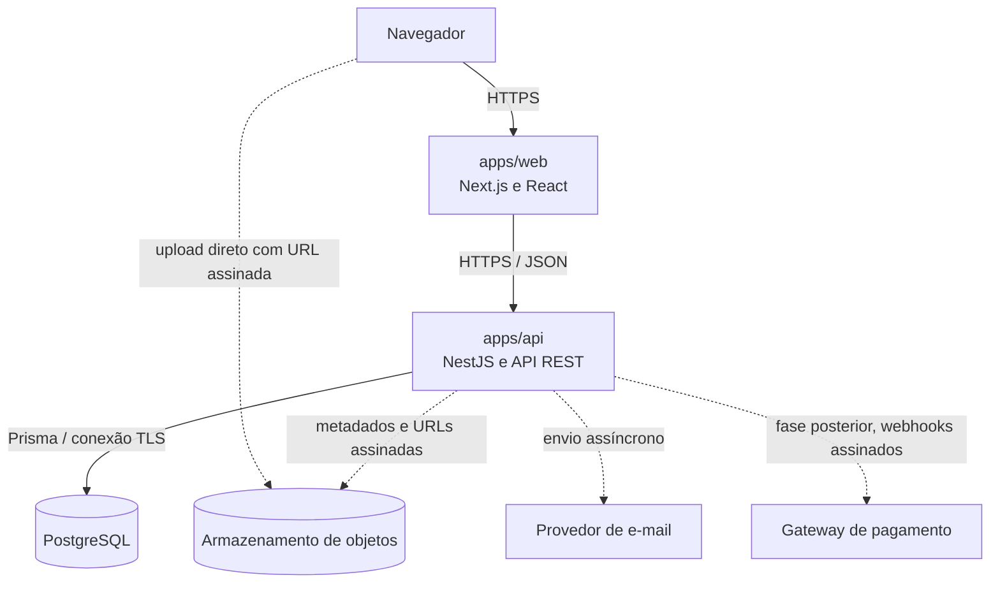
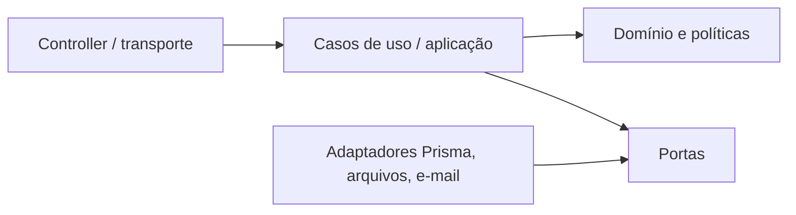

# Arquitetura

## 1. Estado e propósito

Este documento define a arquitetura de referência do Fênix Vôlei e registra o estado implementado. As fases 0 a 5 estão entregues (ver relatórios `19` a `24`); a tabela da seção 8 indica o estado de cada domínio.

As decisões vinculantes e seus motivos estão em [17-DECISOES-TECNICAS.md](./17-DECISOES-TECNICAS.md). Questões ainda abertas estão em [`PENDENCIAS.md`](../PENDENCIAS.md).

## 2. Direcionadores

- aplicação web responsiva, com páginas públicas indexáveis e áreas autenticadas;
- regras administrativas, financeiras e de autorização centralizadas no servidor;
- rastreabilidade de operações financeiras e administrativas;
- tratamento adequado de dados pessoais, dados de menores e anexos;
- evolução por módulos sem distribuir prematuramente o sistema em microsserviços;
- portabilidade entre provedores compatíveis com Node.js e PostgreSQL;
- contratos verificáveis por OpenAPI, tipos compartilhados apenas quando não acoplarem camadas;
- modo estrito do TypeScript, validação nas bordas e testes proporcionais ao risco.

## 3. Visão de contexto



Parceiros não recebem acesso administrativo por padrão. O perfil, o contrato de acesso e as permissões dessa audiência permanecem pendentes. Responsável por atleta também não é um perfil autorizado nesta fase: o acesso depende de `PEN-010`, vínculo verificável, escopo e fundamento jurídico.

## 4. Contêineres



Estado atual: `web`, `api` e PostgreSQL estão operacionais. Armazenamento de objetos e e-mail usam adaptadores locais atrás das portas `ObjectStorage` e `MailSender` (`DT-024`), substituíveis por provedores reais sem alterar os módulos. O navegador fala apenas com a origem da web: o Next.js encaminha `/api/v1/*` para a API (`DT-022`). Gateway de pagamento permanece fora do escopo implementado.

## 5. Organização do monorepo

```text
apps/
  web/          interface Next.js
  api/          API NestJS
packages/
  ui/           componentes visuais reutilizáveis e sem regra de negócio
  types/        tipos estáveis e independentes de transporte
  config/       configurações compartilhadas
  validation/   schemas reutilizáveis nas bordas permitidas
prisma/
  schema.prisma modelo lógico inicial
docs/           especificação e decisões
```

O gerenciador escolhido é npm workspaces. Não há Turborepo nesta fase: os scripts raiz são suficientes para o tamanho atual e evitam uma camada operacional sem benefício comprovado.

## 6. Arquitetura do frontend

O esqueleto da Fase 0 utiliza App Router do Next.js conforme a decisão provisória `DT-017` e separa:

- `app/`: rotas, layouts, metadata e composição de páginas;
- `components/`: elementos de apresentação;
- `features/`: interface e orquestração específicas de uma capacidade, quando a implementação começar;
- `services/`: cliente HTTP e adaptadores de browser;
- `styles/`: tokens e estilos globais;
- `utils/`: utilitários puros e pequenos.

Regras:

1. componentes não acessam banco nem implementam regra financeira;
2. autorização visual melhora a experiência, mas não substitui autorização da API;
3. dados vindos da rede são tratados como desconhecidos e validados;
4. enquanto `DT-017` estiver provisória, Server Components são a recomendação para conteúdo público e leitura; Client Components ficam restritos à interação necessária;
5. SCSS Modules isolam estilos de componentes; tokens globais sustentam identidade e acessibilidade;
6. estados de carregamento, vazio, erro e sucesso fazem parte do contrato de cada tela;
7. nenhum dado sensível deve ser colocado em HTML estático, analytics ou logs do navegador.

## 7. Arquitetura do backend

O backend começa como monólito modular. Cada módulo futuro deve manter a seguinte direção:



- **Transporte:** REST, DTOs, autenticação, serialização e códigos HTTP.
- **Aplicação:** coordena casos de uso, transações e permissões do caso.
- **Domínio:** invariantes e transições de estado, sem dependência de NestJS ou Prisma.
- **Infraestrutura:** Prisma, armazenamento, e-mail e outros adaptadores.

Controllers permanecem finos. Repositórios não decidem regras. Objetos do Prisma não se tornam automaticamente contratos públicos.

## 8. Limites modulares

| Domínio | Capacidades principais | Fase | Módulo da API | Estado |
|---|---|---:|---|---|
| Identidade e acesso | autenticação, sessões, usuários, papéis e permissões | 1 | `auth`, `access` | implementado |
| Configurações | dados institucionais, marca, termos e parâmetros | 1 | `settings` | implementado |
| Esportivo | atletas, equipes, categorias, interessados, inscrições e seletivas | 2 | `sports` | implementado |
| Mensalidades | planos, cobranças e pagamentos de mensalidade | 3 | `finance` (`FeesService`) | implementado |
| Caixa Fênix | contas, categorias, centros de custo, movimentos, conciliação e fechamento | 3 | `finance` | implementado |
| Comércio | catálogo, variações, estoque, carrinho, favoritos, pedidos e pagamentos | 4 | `store` | implementado |
| Campanhas | remessas, janelas de venda, produção, chegada e retirada | 5 | `campaigns` | implementado |
| Parceiros | contratos, produtos, profissionais, serviços, agenda e repasses | 6 | `partners` | implementado |
| Conteúdo | notícias, eventos, partidas e publicação relacionada | 7 | `content` (`NewsService`, `EventsService`) | implementado |
| Comunidade | fórum, reações, denúncias, moderação e avisos | 7 | `content` (`ForumService`, `AnnouncementsService`) | implementado |
| Plataforma | arquivos, notificações, auditoria, painel, relatórios, privacidade e observabilidade | transversal | `media`, `notifications`, `dashboard`, `reports`, `privacy`, `common` | implementado (observabilidade de produção depende de `PEN-045`) |

Cada módulo segue `DT-023`: `domain/` (regras puras testadas), `application/` (casos de uso, transação, auditoria) e `http/` (controllers finos e DTOs).

Dependências entre domínios ocorrem por identificadores e casos de uso explícitos. Um módulo não consulta tabelas internas de outro para contornar sua política.

## 9. Consistência e transações

Operações que alterem mais de uma responsabilidade crítica devem ter fronteira transacional no backend. Exemplos futuros:

- confirmar mensalidade + registrar pagamento + criar entrada financeira;
- confirmar pedido + registrar pagamento + criar entrada + efetivar movimento de estoque;
- reembolsar pagamento + criar saída vinculada + atualizar o estado permitido;
- transferir entre contas + criar as duas pernas vinculadas da transferência.

O lançamento contábil/gerencial não será atualizado silenciosamente por edição destrutiva. Correções geram novos fatos vinculados, motivo e auditoria. Efeitos externos, como e-mail, serão disparados depois da confirmação da transação; uma caixa de saída transacional será avaliada quando as notificações forem implementadas.

## 10. Modelo de dados

- PostgreSQL é a fonte transacional de verdade.
- Prisma é o ORM e o mecanismo de migrations futuro.
- Identificadores principais usam UUID.
- Instantes usam UTC; datas civis usam `DATE`.
- Dinheiro usa `Decimal`/`NUMERIC`, acompanhado de moeda.
- Exclusão lógica é aplicada onde apagar quebraria histórico ou auditoria.
- Saldo é derivado de movimentações; valores de abertura são eventos controlados, não atalhos editáveis.
- Arquivos ficam fora do banco; somente metadados, hash/chave e localização segura são persistidos.

O detalhamento está em [08-MODELO-DE-DADOS.md](./08-MODELO-DE-DADOS.md), [09-DICIONARIO-DE-DADOS.md](./09-DICIONARIO-DE-DADOS.md) e [diagramas/ERD.md](./diagramas/ERD.md).

## 11. Segurança

Defesa em profundidade:

1. HTTPS em qualquer ambiente exposto;
2. autenticação planejada com sessão revogável, access token curto e refresh rotacionável, ainda condicionada à decisão provisória `DT-012`;
3. autorização por permissão em cada caso de uso administrativo;
4. validação e normalização de entrada no DTO e no domínio;
5. queries parametrizadas pelo Prisma e restrições no banco;
6. CORS por lista explícita e headers seguros;
7. proteção contra força bruta e rate limiting por risco;
8. segredos somente em cofre/ambiente;
9. uploads validados e servidos por acesso controlado;
10. logs estruturados, sem segredo ou dado pessoal desnecessário;
11. auditoria separada de observabilidade operacional;
12. backup criptografado e restauração testada antes da produção.

Detalhes e pendências jurídicas estão em [13-SEGURANCA-E-LGPD.md](./13-SEGURANCA-E-LGPD.md).

## 12. API e contratos

- REST versionada sob `/api/v1`;
- OpenAPI gerado e revisado como contrato;
- JSON em `camelCase`;
- UUID como string, data civil em `YYYY-MM-DD`, instante ISO 8601 UTC;
- dinheiro serializado como string decimal e moeda separada;
- erros no formato Problem Details, com código estável e identificador de correlação;
- idempotência obrigatória para confirmações financeiras e webhooks;
- paginação e filtros com limites defensivos;
- nenhuma resposta administrativa expõe campos privados por conveniência.

O inventário planejado e o único endpoint técnico da Fase 0 constam em [10-API.md](./10-API.md).

## 13. Observabilidade e auditoria

Observabilidade operacional e auditoria têm objetivos diferentes:

- **logs e métricas:** saúde, latência, taxa de erro e capacidade, com retenção operacional;
- **traces/correlation ID:** caminho de uma requisição entre web, API e integrações;
- **auditoria:** quem executou uma ação sensível, quando, por qual motivo e qual entidade foi afetada.

Auditoria não deve copiar senha, token, comprovante ou payload pessoal completo. Campos anteriores/novos exigem minimização e mascaramento por domínio.

## 14. Implantação

O frontend e a API são unidades implantáveis separadas. PostgreSQL gerenciado e armazenamento de objetos privado formam a **topologia de referência recomendada**, não uma escolha aprovada de provedor ou hospedagem; `DT-018`, `PEN-042` e `PEN-048` mantêm essa decisão provisória. O Docker Compose serve apenas ao PostgreSQL de desenvolvimento. Imagens de produção, CI/CD, região, provedor e objetivos de recuperação dependem das decisões listadas em `PENDENCIAS.md`.

## 15. Restrições vigentes

Ainda não fazem parte do escopo implementado:

- upload em nuvem e envio real de e-mail (adaptadores locais, `DT-024`);
- checkout com cartão, PIX automatizado ou gateway (`PEN-026`);
- MFA para perfis privilegiados (`PEN-013`, exigido antes de produção);
- relatórios assíncronos, monitoramento e alertas de produção (`PEN-045`, `PEN-049`).

### Rotinas internas

A API executa, a cada 10 minutos, a expiração de reservas de pedidos não pagos, o encerramento de remessas com prazo vencido e a limpeza das contagens de limite de requisições. As tarefas são idempotentes, auditadas quando mudam dados, podem ser disparadas pelo painel e são desligadas em testes (`SCHEDULED_JOBS=off`, ou o nome antigo `ORDER_EXPIRY_JOB=off`, desativa em qualquer ambiente).

Avisos por e-mail e WhatsApp (`DT-048`): `NotificationsService.notify` grava o aviso do painel e, pela finalidade e escolha da pessoa, coloca envios em `notification_deliveries`. `DeliveryService` processa a fila logo após o aviso e a cada 30 segundos, reservando lotes com `FOR UPDATE SKIP LOCKED`; os adaptadores `MailSender` (arquivo ou SMTP) e `WhatsAppSender` (desligado, arquivo ou WhatsApp Cloud API) isolam o provedor. Os lembretes de mensalidade rodam de hora em hora (`FeeRemindersService`).

Tempo real (`DT-049`): `GET /api/v1/me/events` (Server-Sent Events) entrega avisos sem dados (`notification`, `changed`); `RealtimeService` espalha os eventos entre servidores com `LISTEN/NOTIFY` do PostgreSQL, e o navegador busca de novo pela API.

Com mais de um servidor, cada tarefa roda em um só deles por intervalo: `JobScheduler` reserva a tarefa na tabela `scheduled_job_leases` e guarda a última execução e o tipo do erro, se houver. O limite de requisições conta no PostgreSQL (`rate_limit_buckets`), igual para todos os servidores; se o banco falhar, cada servidor conta na própria memória até ele voltar (`DT-047`).
