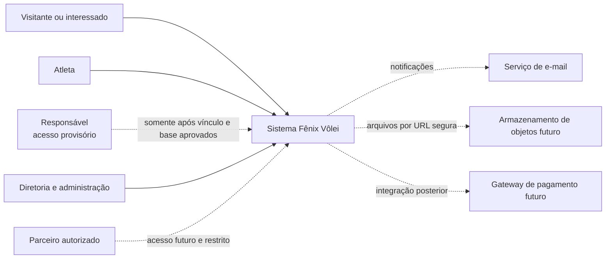
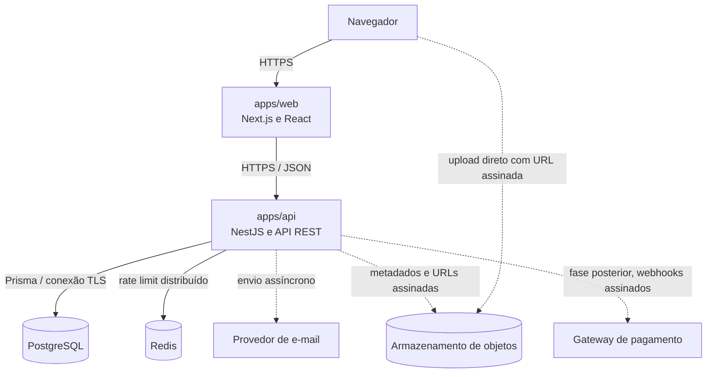
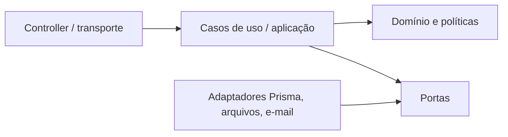

# Arquitetura

## 1. Estado e propósito

Este documento define a arquitetura de referência incremental. Em 29/07/2026 a
base técnica da Fase 1 e as primeiras entregas verticais das Fases 2 e 3 estão
implementadas em local/teste. Os módulos futuros continuam somente planejados.

As decisões vinculantes e seus motivos estão em [17-DECISOES-TECNICAS.md](./17-DECISOES-TECNICAS.md). Questões ainda abertas estão em [`PENDENCIAS.md`](../PENDENCIAS.md).

## 2. Direcionadores

- aplicação web responsiva, com páginas públicas indexáveis e áreas autenticadas;
- regras administrativas, financeiras e de autorização centralizadas no servidor;
- rastreabilidade de operações financeiras e administrativas;
- tratamento adequado de dados pessoais, dados de menores e anexos;
- evolução por módulos sem distribuir prematuramente o sistema em microsserviços;
- portabilidade entre provedores compatíveis com Node.js e PostgreSQL;
- contratos verificáveis por OpenAPI, tipos compartilhados apenas quando não acoplarem camadas;
- modo estrito do TypeScript, validação nas bordas e testes proporcionais ao risco.

## 3. Visão de contexto



Parceiros não recebem acesso administrativo por padrão. O perfil, o contrato de acesso e as permissões dessa audiência permanecem pendentes. Responsável por atleta também não é um perfil autorizado nesta fase: o acesso depende de `PEN-010`, vínculo verificável, escopo e fundamento jurídico.

## 4. Contêineres



Web, API, PostgreSQL, Redis e SMTP estão integrados no ambiente local. Mailpit é
apenas o capturador efêmero; nenhum provedor comercial foi escolhido.
Armazenamento de objetos e gateway de pagamento permanecem fronteiras
planejadas, não integrações disponíveis.

## 5. Organização do monorepo

```text
apps/
  web/          interface Next.js
  api/          API NestJS
packages/
  ui/           componentes visuais reutilizáveis e sem regra de negócio
  types/        tipos estáveis e independentes de transporte
  config/       configurações compartilhadas
  validation/   schemas reutilizáveis nas bordas permitidas
prisma/
  schema.prisma schema físico executável da fase atual
  migrations/   histórico físico incremental
docs/           especificação e decisões
```

O gerenciador escolhido é npm workspaces. Não há Turborepo nesta fase: os scripts raiz são suficientes para o tamanho atual e evitam uma camada operacional sem benefício comprovado.

## 6. Arquitetura do frontend

O esqueleto da Fase 0 utiliza App Router do Next.js conforme a decisão provisória `DT-017` e separa:

- `app/`: rotas, layouts, metadata e composição de páginas;
- `components/`: elementos de apresentação;
- `features/`: interface e orquestração específicas de uma capacidade, quando a implementação começar;
- `services/`: cliente HTTP e adaptadores de browser;
- `styles/`: tokens e estilos globais;
- `utils/`: utilitários puros e pequenos.

Regras:

1. componentes não acessam banco nem implementam regra financeira;
2. autorização visual melhora a experiência, mas não substitui autorização da API;
3. dados vindos da rede são tratados como desconhecidos e validados;
4. enquanto `DT-017` estiver provisória, Server Components são a recomendação para conteúdo público e leitura; Client Components ficam restritos à interação necessária;
5. SCSS Modules isolam estilos de componentes; tokens globais sustentam identidade e acessibilidade;
6. estados de carregamento, vazio, erro e sucesso fazem parte do contrato de cada tela;
7. nenhum dado sensível deve ser colocado em HTML estático, analytics ou logs do navegador.

## 7. Arquitetura do backend

O backend começa como monólito modular. Cada módulo futuro deve manter a seguinte direção:



- **Transporte:** REST, DTOs, autenticação, serialização e códigos HTTP.
- **Aplicação:** coordena casos de uso, transações e permissões do caso.
- **Domínio:** invariantes e transições de estado, sem dependência de NestJS ou Prisma.
- **Infraestrutura:** Prisma, armazenamento, e-mail e outros adaptadores.

Controllers permanecem finos. Repositórios não decidem regras. Objetos do Prisma não se tornam automaticamente contratos públicos.

No recorte `fase_1_admin_auditoria`, a API está dividida em módulos NestJS de
`auth`, `access-control`, `users`, `audit` e `database`. Guardas globais resolvem
sessão, CSRF e permissões; serviços coordenam regras e transações; o adaptador
Prisma permanece na infraestrutura. O frontend consome apenas REST com cookies e
não importa código do backend.

## 8. Limites modulares

| Domínio | Capacidades principais | Fase |
|---|---|---:|
| Identidade e acesso | autenticação, sessões, usuários, papéis e permissões | 1 |
| Configurações | dados institucionais, marca, termos e parâmetros | 1 |
| Esportivo | atletas, equipes, categorias, interessados, inscrições e seletivas | 2 |
| Mensalidades | planos, cobranças e pagamentos de mensalidade | 3 |
| Caixa Fênix | contas, categorias, centros de custo, movimentos, conciliação e fechamento | 3 |
| Comércio | catálogo, variações, estoque, carrinho, favoritos, pedidos e pagamentos | 4 |
| Campanhas | remessas, janelas de venda, produção, chegada e retirada | 5 |
| Parceiros | contratos, produtos, profissionais, serviços, agenda e repasses | 6 |
| Conteúdo | notícias, eventos, partidas e publicação relacionada | 7 |
| Comunidade | fórum, reações, denúncias e moderação | 7 |
| Plataforma | arquivos, notificações, auditoria, relatórios e observabilidade | transversal |

Dependências entre domínios ocorrem por identificadores e casos de uso explícitos. Um módulo não consulta tabelas internas de outro para contornar sua política.

## 9. Consistência e transações

Operações que alterem mais de uma responsabilidade crítica devem ter fronteira transacional no backend. Exemplos futuros:

- confirmar mensalidade + registrar pagamento + criar entrada financeira;
- confirmar pedido + registrar pagamento + criar entrada + efetivar movimento de estoque;
- reembolsar pagamento + criar saída vinculada + atualizar o estado permitido;
- transferir entre contas + criar as duas pernas vinculadas da transferência.

O lançamento contábil/gerencial não será atualizado silenciosamente por edição destrutiva. Correções geram novos fatos vinculados, motivo e auditoria. Efeitos externos, como e-mail, serão disparados depois da confirmação da transação; uma caixa de saída transacional será avaliada quando as notificações forem implementadas.

## 10. Modelo de dados

- PostgreSQL é a fonte transacional de verdade.
- Prisma é o ORM e o mecanismo de migrations incremental.
- `prisma/schema.prisma` contém somente modelos promovidos da fase/tarefa autorizada.
- o modelo conceitual completo permanece em documentação e referência não executável.
- Identificadores principais usam UUID.
- Instantes usam UTC; datas civis usam `DATE`.
- Dinheiro usa `Decimal`/`NUMERIC`, acompanhado de moeda.
- Exclusão lógica é aplicada onde apagar quebraria histórico ou auditoria.
- Saldo é derivado de movimentações; valores de abertura são eventos controlados, não atalhos editáveis.
- Arquivos ficam fora do banco; somente metadados, hash/chave e localização segura são persistidos.

O detalhamento e a distinção entre modelo conceitual e físico estão em
[08-MODELO-DE-DADOS.md](./08-MODELO-DE-DADOS.md),
[09-DICIONARIO-DE-DADOS.md](./09-DICIONARIO-DE-DADOS.md) e
[diagramas/ERD.md](./diagramas/ERD.md). A estratégia vinculante está em `DT-024`.

## 11. Segurança

Defesa em profundidade:

1. HTTPS em qualquer ambiente exposto;
2. autenticação implementada localmente com sessão revogável, access token curto,
   refresh opaco rotacionável e detecção de reutilização; parâmetros finais ainda
   dependem de `PEN-013`;
3. autorização por permissão em cada caso de uso administrativo;
4. validação e normalização de entrada no DTO e no domínio;
5. queries parametrizadas pelo Prisma e restrições no banco;
6. CORS por lista explícita e headers seguros;
7. proteção contra força bruta e rate limiting por risco;
8. segredos somente em cofre/ambiente;
9. uploads validados e servidos por acesso controlado;
10. logs estruturados, sem segredo ou dado pessoal desnecessário;
11. auditoria separada de observabilidade operacional;
12. backup criptografado e restauração testada antes da produção.

Detalhes e pendências jurídicas estão em [13-SEGURANCA-E-LGPD.md](./13-SEGURANCA-E-LGPD.md).

## 12. API e contratos

- REST versionada sob `/api/v1`;
- OpenAPI gerado e revisado como contrato;
- JSON em `camelCase`;
- UUID como string, data civil em `YYYY-MM-DD`, instante ISO 8601 UTC;
- dinheiro serializado como string decimal e moeda separada;
- erros no formato Problem Details, com código estável e identificador de correlação;
- idempotência obrigatória para confirmações financeiras e webhooks;
- paginação e filtros com limites defensivos;
- nenhuma resposta administrativa expõe campos privados por conveniência.

O inventário implementado das Fases 1 a 3 e os recursos ainda planejados constam
em [10-API.md](./10-API.md).

## 13. Observabilidade e auditoria

Observabilidade operacional e auditoria têm objetivos diferentes:

- **logs e métricas:** saúde, latência, taxa de erro e capacidade, com retenção operacional;
- **traces/correlation ID:** caminho de uma requisição entre web, API e integrações;
- **auditoria:** quem executou uma ação sensível, quando, por qual motivo e qual entidade foi afetada.

Auditoria não copia senha, token, código de recuperação, comprovante ou payload
pessoal completo. O serviço remove chaves sensíveis por allowlist negativa,
registra IP e agente somente como hash contextual e o banco bloqueia `UPDATE` e
`DELETE` em `audit_logs`. A consulta exige `audit.read`.

## 14. Implantação

O frontend e a API são unidades implantáveis separadas. PostgreSQL gerenciado e
armazenamento de objetos privado formam a **topologia de referência recomendada**,
não uma escolha aprovada de provedor ou hospedagem; `DT-018`, `PEN-042` e
`PEN-048` mantêm essa decisão provisória. O Docker Compose local serve PostgreSQL,
Redis e Mailpit, vinculados ao loopback; Mailpit não é provedor de produção.
Imagens de produção, CI/CD, região, provedor e objetivos de recuperação dependem
das decisões listadas em `PENDENCIAS.md`.

## 15. Restrições do recorte atual

As entregas atuais cobrem a base técnica da Fase 1, a vertical administrativa
esportiva da Fase 2 e a vertical manual do Caixa Fênix da Fase 3. Não fazem
parte:

- área pública/dependente do atleta ou responsável;
- importação real, dados reais de menores ou qualquer dado médico;
- mensalidade automática, multa, juros, pró-rata, PIX ou gateway;
- upload/objeto real, loja, parceiros, fórum completo ou agendamento;
- produção, staging público ou dados iniciais reais.

A logo principal oficial está aplicada; variantes e paleta canônica permanecem
pendentes. Produção continua bloqueada pelos gates institucionais e P0.
