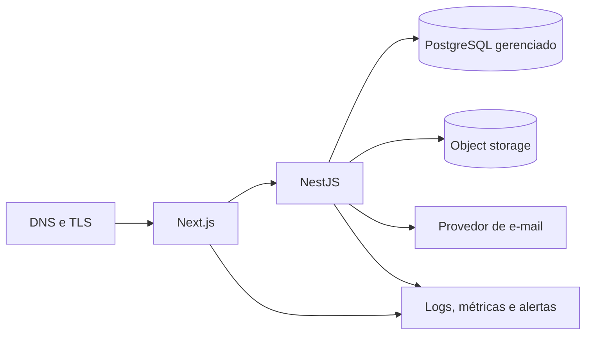
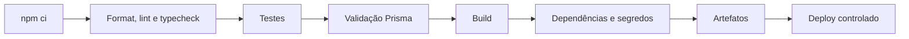

# Deploy e infraestrutura

## 1. Escopo do ambiente local

O ambiente de desenvolvimento valida:

- instalação das dependências do monorepo;
- formatação, lint, tipos, testes, validação Prisma e build de web, API e pacotes;
- inicialização local da página Next.js;
- inicialização local da API NestJS e seu endpoint de saúde;
- PostgreSQL via Docker Compose.

O Compose não representa uma topologia de produção e não inclui aplicação, proxy, armazenamento, e-mail ou gateway de pagamento.

## 2. Ambientes

| Ambiente | Finalidade | Dados |
|---|---|---|
| local | desenvolvimento individual | sintéticos |
| test | testes automatizados isolados | descartáveis |
| staging | validação integrada e aceite | sintéticos ou anonimizados |
| production | operação oficial | reais, com controles LGPD |

Credenciais, bancos, buckets e chaves são exclusivos por ambiente. Cópias de produção não podem ser levadas ao desenvolvimento sem base legal, minimização e anonimização verificável.

## 3. Topologia de referência



Esta topologia é uma referência provisória de avaliação conforme `DT-018`, não uma escolha de provedor. Região, serviços, recuperação e orçamento dependem de `PEN-042`, `PEN-044` e `PEN-048`.

Requisitos de produção:

- TLS válido e renovação automática;
- API e banco em rede restrita sempre que o provedor permitir;
- conexão com PostgreSQL criptografada;
- backups automáticos e restauração testada;
- armazenamento de objetos privado por padrão;
- segredos em cofre do provedor;
- logs com retenção e acesso mínimo;
- health checks, métricas e alertas;
- proteção contra abuso na borda e na aplicação.

## 4. Desenvolvimento local

Pré-requisitos:

- versão de Node.js compatível indicada no `package.json`;
- npm compatível;
- Docker Desktop ou Docker Engine com Compose v2;
- Git.

Fluxo esperado:

```bash
npm ci
docker compose up -d postgres
npm run dev
```

As portas, nomes de scripts e comandos de verificação oficiais são mantidos no [`README.md`](../README.md). Copie `.env.example` para `.env` apenas localmente e nunca inclua segredos reais no exemplo.

## 5. PostgreSQL local

O serviço local deve:

- usar imagem oficial com versão de patch e digest multi-arquitetura fixados; atualização exige revisão e nova validação;
- expor uma porta configurável apenas para desenvolvimento e vinculada a `127.0.0.1`;
- persistir em volume nomeado;
- possuir `healthcheck`;
- receber usuário, senha e banco por variáveis;
- evitar credenciais reutilizáveis em produção.

Comandos operacionais:

```bash
docker compose up -d postgres
docker compose ps
docker compose logs postgres
docker compose down
```

`docker compose down -v` remove o volume e os dados locais. Esse comando é destrutivo e não faz parte do fluxo normal.

## 6. Variáveis de ambiente

Categorias previstas:

| Categoria | Exemplos | Regra |
|---|---|---|
| runtime | `NODE_ENV`, portas e URLs públicas | valor por ambiente |
| banco | `DATABASE_URL` | segredo fora do repositório |
| autenticação | chaves e durações | cofre, rotação e separação por ambiente |
| CORS/cookies | origens e domínio | lista explícita |
| arquivos | bucket, região e credenciais | menor privilégio |
| e-mail | remetente e credencial | domínio verificado |
| observabilidade | endpoint e chave | sem payload pessoal desnecessário |
| pagamentos | chaves e segredo de webhook | somente a partir da fase autorizada |

Variáveis implementadas (valores de exemplo em `.env.example`):

| Variável | Uso | Obrigatória em produção |
|---|---|---|
| `NODE_ENV`, `PORT`, `API_PORT` | runtime e portas | sim |
| `API_INTERNAL_URL` | endereço interno da API usado pelo Next.js (servidor e proxy) | sim |
| `WEB_ORIGIN` | origem pública: CORS, validação de `Origin` e links de e-mail | sim |
| `DATABASE_URL`, `POSTGRES_*` | banco | sim |
| `AUTH_ACCESS_TOKEN_SECRET` | assinatura do access token (mín. 32 caracteres) | sim |
| `DATA_ENCRYPTION_KEY` | chave AES-256 (32 bytes base64) de PIX, banco e documentos | sim |
| `STORAGE_DRIVER`, `STORAGE_LOCAL_DIR` | armazenamento de arquivos; caminho absoluto fora do projeto, volume persistente em produção (DT-038) | adaptador de nuvem pendente (`PEN-042`) |
| `BACKUP_DIR`, `BACKUP_KEEP` | destino e retenção de `npm run backup` (DT-038) | — |
| `MAIL_DRIVER`, `MAIL_OUTBOX_DIR`, `MAIL_FROM` | e-mail: `outbox` (teste, grava em arquivo) ou `smtp` (DT-048) | `smtp` em produção |
| `SMTP_HOST`, `SMTP_PORT`, `SMTP_SECURE`, `SMTP_USER`, `SMTP_PASSWORD` | servidor SMTP do provedor; 587 com STARTTLS obrigatório ou 465 com TLS | com `MAIL_DRIVER=smtp` |
| `WHATSAPP_DRIVER`, `WHATSAPP_OUTBOX_DIR` | `off` (padrão em produção), `outbox` (teste, padrão fora de produção) ou `cloud` (Meta) (DT-048) | não |
| `WHATSAPP_PHONE_NUMBER_ID`, `WHATSAPP_ACCESS_TOKEN`, `WHATSAPP_TEMPLATE_NAME`, `WHATSAPP_TEMPLATE_LANGUAGE`, `WHATSAPP_API_VERSION` | WhatsApp Cloud API: número, token permanente do usuário de sistema e modelo aprovado (padrão `fenix_aviso`, `pt_BR`, `v23.0`) | com `WHATSAPP_DRIVER=cloud` |
| `ALLOW_LOCAL_ADAPTERS_IN_PRODUCTION` | opt-in explícito para adaptadores locais | — |
| `STORE_RESERVATION_HOURS` | validade da reserva de pedido não pago (padrão 72) | não |
| `SCHEDULED_JOBS` | `off` desativa as tarefas automáticas neste servidor (`ORDER_EXPIRY_JOB=off`, nome antigo, também vale) | não |
| `THROTTLE_STORE` | `postgres` (padrão, contagem comum a todos os servidores) ou `memory` (só desenvolvimento com um servidor) (DT-047) | não |
| `REALTIME`, `REALTIME_DATABASE_URL` | `off` desliga o tempo real; conexão direta ao PostgreSQL para o `LISTEN` quando `DATABASE_URL` passa por pooler em modo transação (DT-049) | não |
| `THROTTLE_DISABLED` | desliga rate limit fora de produção (testes) | não |
| `SEED_ADMIN_*` | administrador inicial criado pelo seed | apenas no primeiro deploy |

A aplicação falha cedo quando uma variável obrigatória está ausente ou inválida.
No ambiente local, o Next.js recebe sua porta pela variável nativa `PORT`, enquanto a API usa `API_PORT`. Os scripts não dependem de expansão de variável específica do shell.

## 7. Banco, migrations e seed

Comandos implementados:

| Comando | Efeito |
|---|---|
| `npm run db:migrate` | `prisma migrate deploy` (aplica migrations pendentes) |
| `npm run db:migrate:dev` | cria nova migration em desenvolvimento |
| `npm run db:seed` | idempotente: catálogo de permissões e papéis, plano de contas, contas e formas de pagamento padrão, configuração do time e administrador inicial (somente se não houver administrador) |
| `npm run db:setup` | `db:migrate` + `db:seed` |
| `npm run db:demo` | dados fictícios de demonstração; recusa `NODE_ENV=production` |

Estratégia de mudança:

1. mudanças entram em `schema.prisma`;
2. migration é criada e revisada no desenvolvimento;
3. CI valida formatação, schema e compatibilidade;
4. backup e plano de rollback são verificados para alterações de risco;
5. deployment executa migration uma única vez antes de liberar a versão;
6. seed de produção contém apenas dados institucionais autorizados, nunca dados pessoais de exemplo.

Não se usa `db push` como mecanismo de mudança de produção. Migrations destrutivas exigem plano específico e aprovação.

## 8. Pipeline de CI proposto



O gate executável de validação é `npm run check`, após `npm ci`; ele agrega formatação, lint, tipos, testes, validação Prisma e build. Em pull requests, o pipeline termina antes do deploy. Produção exige branch protegida, revisão, ambiente protegido e aprovação definida pela governança do projeto.

A CI da Fase 0 também executa `npm audit --audit-level=high` e o smoke de web/API. Varredura de imagem, segredos e código será adicionada somente com ferramenta aprovada e pinada; até lá, permanece requisito do pipeline-alvo, não controle já implantado.

## 9. Estratégia de release

- versionamento semântico após o primeiro release;
- `CHANGELOG.md` atualizado com mudanças relevantes;
- artefatos imutáveis promovidos entre ambientes;
- migrations compatíveis com implantação gradual quando houver mais de uma instância;
- rollback de aplicação sem apagar dados;
- feature flags somente quando houver necessidade real e responsável definido.

## 10. Backups e recuperação

Antes de produção devem ser aprovados:

- RPO e RTO;
- frequência e retenção de backups;
- cópia em região/conta separada quando necessário;
- criptografia e gestão de chaves;
- procedimento de restauração;
- teste periódico com evidência;
- backup e versionamento de objetos;
- responsáveis por incidente e comunicação.

Um backup não testado não é considerado estratégia de recuperação.

### 10.1 Runbook de backup e restauração (PostgreSQL + arquivos)

Procedimento validado em 19/10/2026 no ambiente local (Fase 8). **Metas aprovadas pelo responsável em 20/10/2026 (`PEN-044`):** backup diário automático entre 01h e 03h (fuso do time), perda máxima de 1 dia de dados (RPO 24 h) e restabelecimento em até 1 dia (RTO 24 h). Recomendação de retenção até a escolha do provedor: 30 cópias diárias e teste de restauração mensal.

**O que compõe um backup completo**

1. banco PostgreSQL (dump lógico no formato `custom`);
2. objetos enviados (logos, capas, documentos, comprovantes): diretório `STORAGE_LOCAL_DIR` no adaptador local ou o bucket do provedor escolhido (`PEN-042`), com versionamento;
3. **a chave `DATA_ENCRYPTION_KEY`**, guardada no cofre de segredos e **nunca junto do dump**: sem ela, documentos, PIX e dados bancários cifrados ficam irrecuperáveis; com ela junto do dump, o vazamento do backup expõe esses dados.

**Gerar o backup (local, Docker Compose)**

```bash
npm run backup
```

O comando (DT-038) grava em `BACKUP_DIR`, fora da pasta do projeto, a pasta `fenix-AAAAMMDD-HHMMSS` com `database.dump` (lido por inteiro pelo `pg_restore`), `storage/` (cópia de `STORAGE_LOCAL_DIR`) e `manifest.json` (SHA-256 e contagens), e mantém as `BACKUP_KEEP` cópias mais recentes (padrão 30). Para cumprir a meta diária, agende-o no Agendador de Tarefas do Windows:

```powershell
schtasks /Create /TN "Fenix Volei - backup diario" /SC DAILY /ST 02:00 /TR "cmd /c cd /d C:\Users\William\Desktop\Fenix && npm run backup >> C:\Users\William\FenixVolei-dados\backups\backup.log 2>&1"
```

O computador precisa estar ligado e o contêiner do PostgreSQL em execução no horário. Equivalente manual, só do banco:

```bash
docker exec fenix-postgres-1 pg_dump -U fenix -d fenix -Fc > backup-AAAAMMDD-HHMM.dump
```

Em produção, use o backup gerenciado do provedor (PITR quando disponível) e, adicionalmente, um dump lógico periódico cifrado em conta/região separada.

**Restaurar e verificar (sempre primeiro em banco de teste)**

```bash
docker exec fenix-postgres-1 createdb -U fenix fenix_restore_test
docker exec -i fenix-postgres-1 pg_restore -U fenix -d fenix_restore_test --no-owner < backup-AAAAMMDD-HHMM.dump
```

Verificações mínimas antes de promover a restauração:

- `_prisma_migrations`: mesmo número de migrations concluídas da versão implantada;
- contagem de `users`, `orders`, `financial_transactions`, `audit_logs`, `partner_settlements` igual à origem (ou ao relatório do instante do backup);
- saldo derivado: `select sum(case when direction='INCOME' then amount else -amount end) from financial_transactions where status='CONFIRMED'` igual ao saldo do painel do Caixa no instante do backup;
- amostra de arquivos: abrir um comprovante e um logo pelo sistema apontado ao banco restaurado;
- decifrar um campo cifrado (ex.: abrir a ficha de um parceiro com documento) para confirmar a chave correta.

Para promover: colocar a aplicação em manutenção, restaurar no banco definitivo, rodar `npm run db:migrate` (somente aplica migrations faltantes), subir a API e conferir `/health`, login e um relatório do Caixa. Registrar data, responsável, backup usado e resultado.

**Evidência do teste local (19/10/2026)**

| Verificação | Origem | Restaurado |
|---|---:|---:|
| `users` | 366 | 366 |
| `orders` | 78 | 78 |
| `financial_transactions` | 198 | 198 |
| `audit_logs` | 2714 | 2714 |
| `partner_settlements` | 9 | 9 |
| saldo derivado (BRL) | 9044,20 | 9044,20 |
| migrations concluídas | 5 | 5 |

Os dados são fictícios de desenvolvimento e teste. O teste periódico deve ser repetido em homologação com cópia anonimizada, mensalmente.

### 10.2 Teste de carga básico

`node scripts/load-test.mjs <baseUrl> <conexões> <segundos>` mede p50/p95/p99, vazão e erros das rotas públicas mais acessadas. O rate limit global (300 req/min por IP) responde 429 de propósito; para medir a aplicação, use uma instância fora de produção com `THROTTLE_DISABLED=true`. Linha de base local (19/10/2026, 20 conexões, 15 s, API compilada e PostgreSQL em Docker): 485 req/s, zero erros, p95 entre 20 ms (`/health`) e 89 ms (`/public/products`). Metas de SLO ainda dependem de `PEN-050`.

## 11. Monitoramento

Sinais mínimos:

- disponibilidade e latência de web/API;
- taxa de respostas 4xx/5xx;
- saturação de CPU/memória/conexões;
- saúde, espaço e latência do PostgreSQL;
- falhas de job, e-mail, upload e webhook;
- crescimento de filas futuras;
- tentativas de login e rate limiting de forma agregada;
- sucesso e duração de backups.

Alertas precisam de severidade, janela, canal e responsável. Logs não substituem métricas, e auditoria não deve ser usada como log genérico.

## 12. Segurança operacional

- imagens e dependências atualizadas com janela definida;
- princípio do menor privilégio em banco, bucket e CI;
- MFA nas contas de infraestrutura;
- nenhuma chave de produção em estação local ou pull request;
- rotação após exposição suspeita;
- cabeçalhos de segurança e CORS testados;
- endpoint de health sem dados de configuração;
- Swagger disponível somente quando `NODE_ENV` for diferente de `production`, em `/docs` e `/docs/openapi.json`; ambas as rotas devem responder `404` em produção;
- plano de resposta a incidente alinhado ao [`SECURITY.md`](../SECURITY.md).

## 13. Pendências para produção

Provedor, domínio, orçamento, região de dados, escala, objetivos de recuperação, monitoramento, e-mail e armazenamento ainda precisam de aprovação. Consulte [`PENDENCIAS.md`](../PENDENCIAS.md) e [18-ESTUDO-DE-VIABILIDADE.md](./18-ESTUDO-DE-VIABILIDADE.md).

## Avisos por e-mail e WhatsApp (DT-048)

Sem credenciais, tudo funciona em modo de teste: e-mails vão para `MAIL_OUTBOX_DIR` e mensagens de WhatsApp para `WHATSAPP_OUTBOX_DIR`, como arquivos. Para enviar de verdade:

1. **E-mail:** contratar um provedor SMTP (ex.: Brevo, Amazon SES, Google Workspace), validar o domínio do remetente (SPF, DKIM e DMARC) e preencher `MAIL_DRIVER=smtp`, `SMTP_*` e `MAIL_FROM` com um endereço desse domínio.
2. **WhatsApp:** na Meta (WhatsApp Business Platform), registrar o número do clube, criar um usuário de sistema com token permanente e cadastrar o modelo de mensagem de categoria **Utilidade**, idioma português (Brasil), com o nome de `WHATSAPP_TEMPLATE_NAME` e quatro variáveis no corpo, nesta ordem:

   ```text
   Olá, {{1}}! {{2}}: {{3}} Acesse: {{4}}
   ```

   Depois da aprovação do modelo, preencher `WHATSAPP_DRIVER=cloud` e `WHATSAPP_*`. Com o recurso de coexistência da Meta, o número do clube continua respondendo conversas pelo aplicativo WhatsApp Business; sem ele, as respostas das pessoas chegam só pela API (`PEN-064`).
3. Conferir em Painel → Avisos a situação dos canais e as falhas dos últimos dias.

## Produção com Docker (DT-053)

1. Copie `.env.example` para `.env.production` (nunca versionado) e preencha: `POSTGRES_*`, `WEB_ORIGIN` (ex.: `https://fenixvolei.com.br`), `SERVER_NAME` (ex.: `fenixvolei.com.br`), `SITE_REVALIDATE_SECRET`, `AUTH_ACCESS_TOKEN_SECRET`, `DATA_ENCRYPTION_KEY`, `S3_*`, `MAIL_*`/`SMTP_*` e, no primeiro deploy, `SEED_ADMIN_*`.
2. Certificado: coloque `fullchain.pem` e `privkey.pem` em `infra/certs` (ou aponte `CERTS_DIR`). Com Let's Encrypt, o desafio HTTP é servido em `/.well-known/acme-challenge/`.
3. Suba: `docker compose -f docker-compose.prod.yml --env-file .env.production up -d --build`. A ordem é automática: banco → migrações → preparo → API → site → Nginx.
4. Bucket: crie o bucket privado no provedor e ative o versionamento. Com o S3 próprio, use `--profile s3-proprio` e crie o bucket uma vez: `docker compose -f docker-compose.prod.yml exec s3 sh -c "echo 's3.bucket.create -name fenix' | weed shell"`.
5. Arquivos já existentes em disco: com `STORAGE_DRIVER=local` e as variáveis `S3_*` preenchidas, rode `npm run storage:migrate -- --simular`, depois `npm run storage:migrate`, e só então mude para `STORAGE_DRIVER=s3`.
6. Backup: o banco segue com `pg_dump` (volume `postgres_data`); os arquivos ficam no S3 com versionamento.

| Variável | Uso |
|---|---|
| `TRUST_PROXY` | quem pode informar o IP real; `loopback` (padrão) ou, atrás do Nginx em contêiner, `loopback,uniquelocal` |
| `STORAGE_DRIVER=s3`, `S3_BUCKET`, `S3_REGION`, `S3_ENDPOINT`, `S3_ACCESS_KEY_ID`, `S3_SECRET_ACCESS_KEY`, `S3_FORCE_PATH_STYLE`, `S3_SERVER_SIDE_ENCRYPTION` | armazenamento S3 ou compatível; endereço público só com `https`; criptografia no servidor ligada salvo `off` |
| `HTTP_PORT`, `HTTPS_PORT`, `CERTS_DIR`, `SERVER_NAME` | portas publicadas pelo Nginx, pasta dos certificados e domínio |
