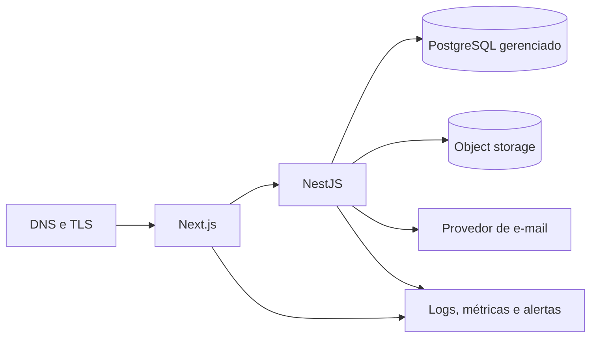
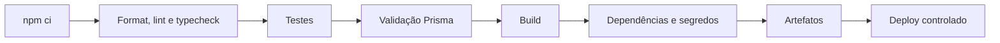

# Deploy e infraestrutura

## 1. Base local das Fases 1 a 3

O ambiente inicial valida:

- instalação das dependências do monorepo;
- formatação, lint, tipos, testes, validação Prisma e build de web, API e pacotes;
- inicialização local da página Next.js;
- inicialização local da API NestJS e seu endpoint de saúde;
- PostgreSQL via Docker Compose;
- Redis local para rate limit distribuído;
- captura de e-mail local efêmera via Mailpit;
- migrations físicas incrementais da fase vigente em banco isolado.

O Compose não representa uma topologia de produção e não inclui aplicação, proxy,
armazenamento, provedor real de e-mail ou gateway de pagamento. Mailpit serve
somente para capturar mensagens locais e não possui dados persistentes. As
entregas técnicas das Fases 1 a 3 estão autorizadas somente para desenvolvimento
local/teste com dados fictícios.

## 2. Ambientes

| Ambiente | Finalidade | Dados |
|---|---|---|
| local | desenvolvimento individual | sintéticos |
| test | testes automatizados isolados | descartáveis |
| staging | validação integrada e aceite | sintéticos ou anonimizados |
| production | operação oficial | reais, com controles LGPD |

Credenciais, bancos, buckets e chaves são exclusivos por ambiente. Cópias de produção não podem ser levadas ao desenvolvimento sem base legal, minimização e anonimização verificável.

## 3. Topologia de referência



Esta topologia é uma referência provisória de avaliação conforme `DT-018`, não uma escolha de provedor. Região, serviços, recuperação e orçamento dependem de `PEN-042`, `PEN-044` e `PEN-048`.

Requisitos de produção:

- TLS válido e renovação automática;
- API e banco em rede restrita sempre que o provedor permitir;
- conexão com PostgreSQL criptografada;
- backups automáticos e restauração testada;
- armazenamento de objetos privado por padrão;
- segredos em cofre do provedor;
- logs com retenção e acesso mínimo;
- health checks, métricas e alertas;
- proteção contra abuso na borda e na aplicação.

## 4. Desenvolvimento local

Pré-requisitos:

- versão de Node.js compatível indicada no `package.json`;
- npm compatível;
- Docker Desktop ou Docker Engine com Compose v2;
- Git.

Fluxo esperado:

```bash
npm ci
docker compose up -d postgres redis mailpit
npm run prisma:migrate:deploy
npm run admin:bootstrap
npm run dev
```

As portas, nomes de scripts e comandos de verificação oficiais são mantidos no [`README.md`](../README.md). Copie `.env.example` para `.env` apenas localmente e nunca inclua segredos reais no exemplo.
As três variáveis `BOOTSTRAP_ADMIN_*` devem ser fornecidas somente no ambiente do
comando. O bootstrap usa trava transacional, falha se já houver administrador,
não pode ser executado em produção e registra a criação na auditoria.

## 5. PostgreSQL local

O serviço local deve:

- usar imagem oficial com versão de patch e digest multi-arquitetura fixados; atualização exige revisão e nova validação;
- expor uma porta configurável apenas para desenvolvimento e vinculada a `127.0.0.1`;
- persistir em volume nomeado;
- possuir `healthcheck`;
- receber usuário, senha e banco por variáveis;
- evitar credenciais reutilizáveis em produção.

Comandos operacionais:

```bash
docker compose up -d postgres
docker compose ps
docker compose logs postgres
docker compose down
```

`docker compose down -v` remove o volume e os dados locais. Esse comando é destrutivo e não faz parte do fluxo normal.

## 6. Variáveis de ambiente

Categorias previstas:

| Categoria | Exemplos | Regra |
|---|---|---|
| runtime | `NODE_ENV`, portas e URLs públicas | valor por ambiente |
| banco | `DATABASE_URL` | segredo fora do repositório |
| autenticação | chaves e durações | cofre, rotação e separação por ambiente |
| MFA | chave de criptografia e versão | 32 bytes, rotação controlada e nunca exposta |
| rate limit | `REDIS_URL` e limites por política | Redis obrigatório fora de desenvolvimento/teste |
| CORS/cookies | origens e domínio | lista explícita |
| arquivos | bucket, região e credenciais | menor privilégio |
| e-mail | remetente e credencial | domínio verificado |
| observabilidade | endpoint e chave | sem payload pessoal desnecessário |
| pagamentos | chaves e segredo de webhook | somente a partir da fase autorizada |
| governança | responsáveis, contatos e aceite de release | obrigatórios em staging/produção |

A aplicação falha cedo quando uma variável obrigatória está ausente ou inválida.
Em staging/produção, `RESPONSIBLE_TECHNOLOGY`, `RESPONSIBLE_PRIVACY`,
`RESPONSIBLE_SECURITY`, `SECURITY_CONTACT_EMAIL`, `PRIVACY_CONTACT_EMAIL`,
`PRODUCTION_RELEASE_APPROVED`, Redis, cookies seguros e segredos fortes são
gates obrigatórios. Dados reais de menores e coleta de saúde permanecem
desabilitados por padrão.
No ambiente local, o Next.js recebe sua porta pela variável nativa `PORT`, enquanto a API usa `API_PORT`. Os scripts não dependem de expansão de variável específica do shell.

## 7. Banco, migrations e seed

Estratégia vigente conforme `PEN-052` e `DT-024`:

1. `docs/referencias/schema-conceitual.prisma`, dicionário e ERD mantêm a visão futura e não são usados por `prisma migrate`;
2. somente modelos da fase e tarefa autorizadas entram em `prisma/schema.prisma`;
3. cada promoção gera migration própria, documentação, testes e allowlist contra tabelas futuras;
4. CI valida formatação, schema, escopo e compatibilidade;
5. a migration é aplicada desde banco vazio e reaplicada por `prisma migrate deploy` em PostgreSQL isolado;
6. backup e plano de rollback são verificados para alterações de risco;
7. deployment executa migrations antes de liberar a versão;
8. seed de produção contém apenas dados institucionais autorizados, nunca dados pessoais de exemplo.

Comandos oficiais:

```bash
npm run prisma:migrate:dev
npm run prisma:migrate:deploy
npm run prisma:migrate:verify
npm run prisma:migrate:diff
npm run prisma:migrate:status
```

As migrations físicas atuais, todas aditivas, são:

1. `fase_1_identidade_acesso`;
2. `fase_1_admin_auditoria`;
3. `fase_1_seguranca_privacidade`;
4. `fase_2_esportivo`;
5. `fase_2_guardian_relationship`;
6. `fase_3_caixa_fenix`.

O gate aplica todas desde banco vazio, compara PostgreSQL ao schema físico e
executa verificações de UUID, `NUMERIC(19,4)`, constraints, FKs e triggers. Um
segundo cenário monta somente as três migrations da Fase 1 e então valida o
upgrade incremental para as Fases 2 e 3 sem diferença de schema.

Não se usa `db push` como mecanismo de mudança de produção. Migrations destrutivas exigem plano específico e aprovação.

## 8. Pipeline de CI proposto



O gate executável de validação é `npm run check`, após `npm ci`; ele agrega formatação, lint, tipos, testes, validação Prisma e build. Em pull requests, o pipeline termina antes do deploy. Produção exige branch protegida, revisão, ambiente protegido e aprovação definida pela governança do projeto.

A CI também executa `npm audit --audit-level=high`, smoke de web/API/Swagger/
OpenAPI, migrations em banco vazio e gates integrados independentes para Fase 1,
Fase 2 e Fase 3. Varredura de
imagem, segredos e código será adicionada somente com ferramenta aprovada e
pinada; até lá, permanece requisito do pipeline-alvo, não controle já implantado.

## 9. Estratégia de release

- versionamento semântico após o primeiro release;
- `CHANGELOG.md` atualizado com mudanças relevantes;
- artefatos imutáveis promovidos entre ambientes;
- migrations compatíveis com implantação gradual quando houver mais de uma instância;
- rollback de aplicação sem apagar dados;
- feature flags somente quando houver necessidade real e responsável definido.

## 10. Backups e recuperação

Antes de produção devem ser aprovados:

- RPO e RTO;
- frequência e retenção de backups;
- cópia em região/conta separada quando necessário;
- criptografia e gestão de chaves;
- procedimento de restauração;
- teste periódico com evidência;
- backup e versionamento de objetos;
- responsáveis por incidente e comunicação.

Um backup não testado não é considerado estratégia de recuperação.

## 11. Monitoramento

Sinais mínimos:

- disponibilidade e latência de web/API;
- taxa de respostas 4xx/5xx;
- saturação de CPU/memória/conexões;
- saúde, espaço e latência do PostgreSQL;
- falhas de job, e-mail, upload e webhook;
- crescimento de filas futuras;
- tentativas de login e rate limiting de forma agregada;
- sucesso e duração de backups.

Alertas precisam de severidade, janela, canal e responsável. Logs não substituem métricas, e auditoria não deve ser usada como log genérico.

## 12. Segurança operacional

- imagens e dependências atualizadas com janela definida;
- princípio do menor privilégio em banco, bucket e CI;
- MFA nas contas de infraestrutura;
- nenhuma chave de produção em estação local ou pull request;
- rotação após exposição suspeita;
- cabeçalhos de segurança e CORS testados;
- endpoint de health sem dados de configuração;
- Swagger disponível somente quando `NODE_ENV` for diferente de `production`, em `/docs` e `/docs/openapi.json`; ambas as rotas devem responder `404` em produção;
- plano de resposta a incidente alinhado ao [`SECURITY.md`](../SECURITY.md).

## 13. Pendências para produção

Responsáveis formais por Tecnologia, Privacidade, Segurança e Financeiro,
provedor, domínio, orçamento, região de dados, escala, RPO/RTO, teste operacional
de restauração, monitoramento, canal de segurança, e-mail e armazenamento ainda
precisam de aprovação. Nenhum gateway financeiro foi escolhido. Consulte
[`PENDENCIAS.md`](../PENDENCIAS.md) e
[18-ESTUDO-DE-VIABILIDADE.md](./18-ESTUDO-DE-VIABILIDADE.md).
