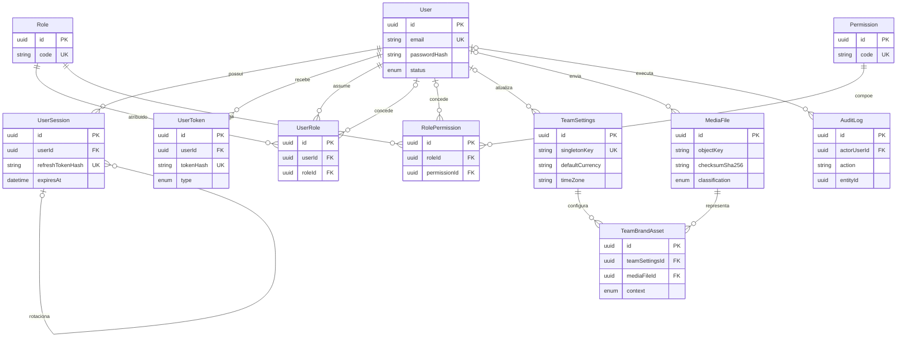
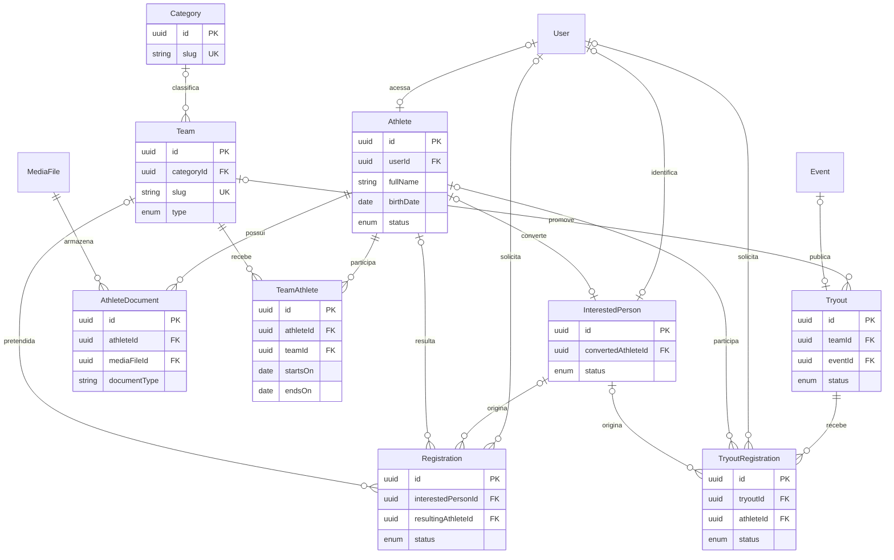
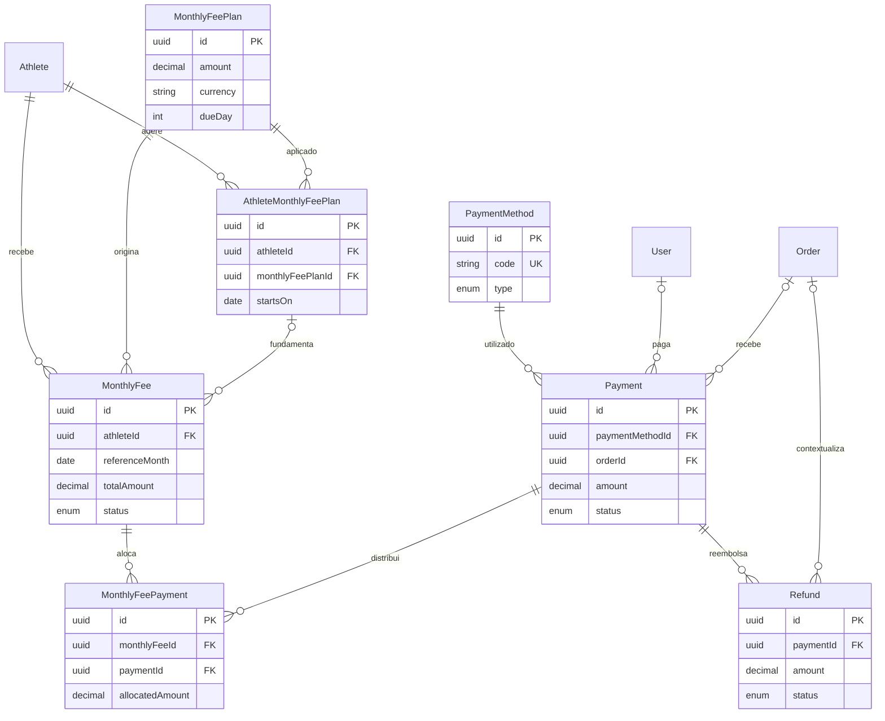
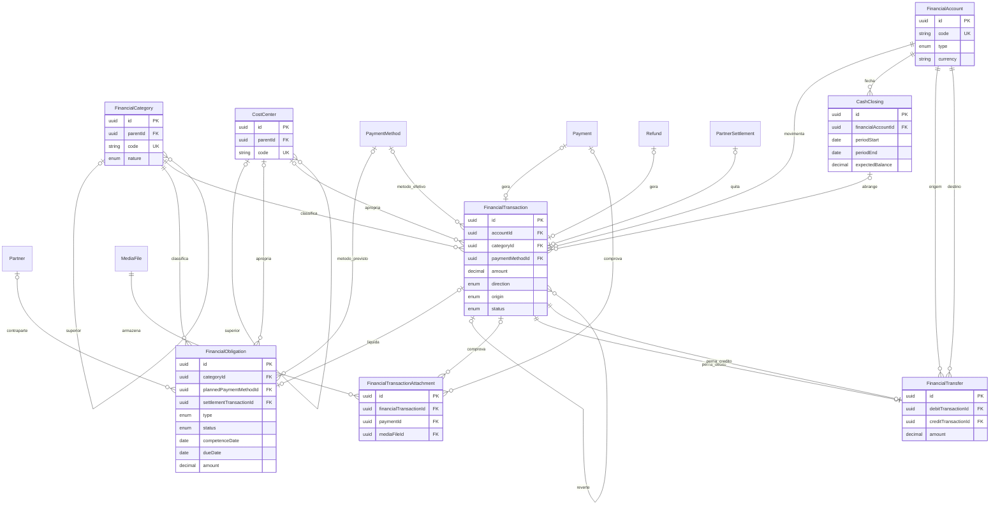
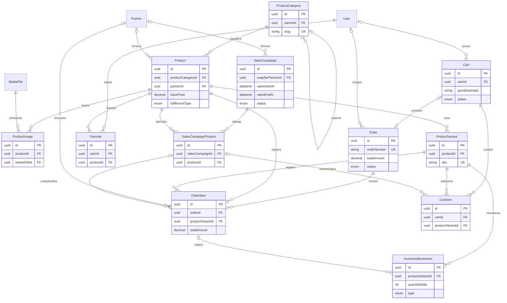
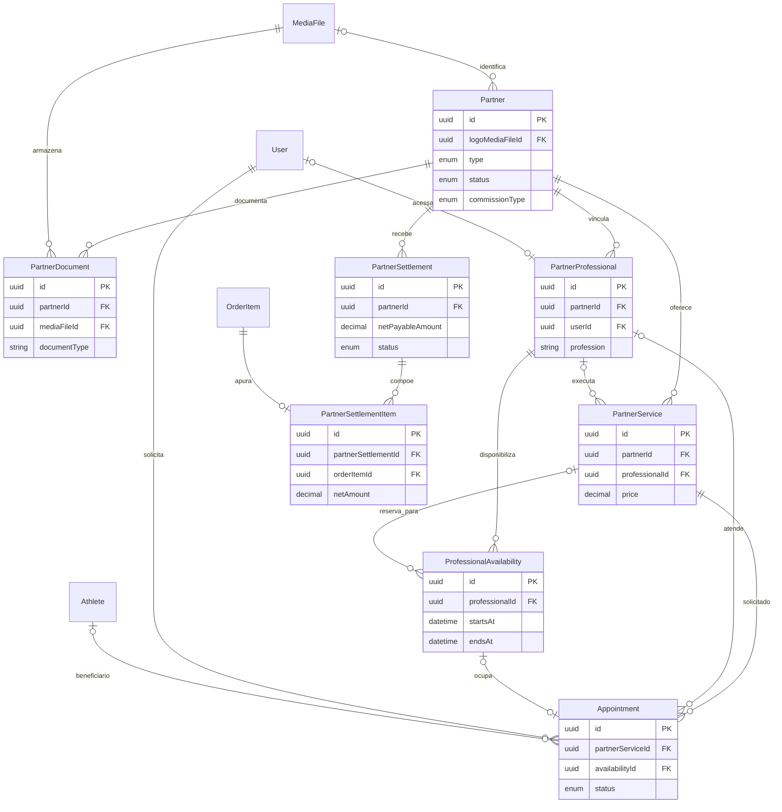
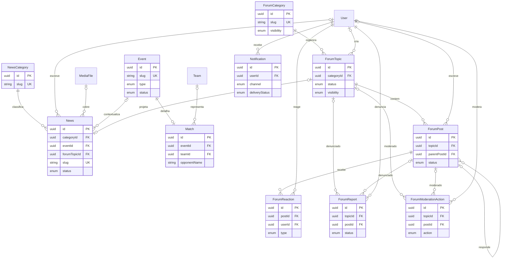

# ERD — Fênix Vôlei

## Leitura

Os diagramas estão separados por domínio para permanecerem legíveis. Entidades repetidas são fronteiras compartilhadas, não tabelas duplicadas. Cardinalidades representam `prisma/schema.prisma`; campos, índices, nulabilidade, `onDelete` e constraints estão em `09-DICIONARIO-DE-DADOS.md`.

- `||`: exatamente um;
- `o|`: zero ou um;
- `|{`: um ou mais;
- `o{`: zero ou mais.

## 1. Identidade, configurações, arquivos e auditoria

## 2. Atletas, equipes, interessados e inscrições

## 3. Mensalidades e pagamentos

## 4. Caixa Fênix

## 5. Loja, estoque e campanhas

## 6. Parceiros, serviços, agenda e repasses

## 7. Notícias, eventos, fórum e notificações

## 8. Restrições complementares

- `Cart`: exatamente um entre `userId` e `guestKeyHash`.
- `ForumReport` e `ForumModerationAction`: exatamente um entre `topicId` e `postId`.
- `FinancialObligation`: `SETTLED` exige `settlementTransactionId` e `settledAt`; obrigação aberta não compõe saldo.
- `PaymentMethod`: obrigação pode indicar o método previsto e movimentação registra o método efetivo; uma origem `Payment` mantém método e moeda coerentes.
- `FinancialTransfer`: contas e pernas distintas, com o mesmo valor/moeda e sentidos opostos.
- `FinancialTransaction`: a FK de origem automática corresponde ao enum `origin`; uma movimentação não tem duas origens automáticas.
- `CashClosing`: movimentações abrangidas pertencem à mesma conta e moeda e ocorrem dentro do período fechado.
- Loja/estoque: produto, variante e produto de campanha de carrinho/pedido são coerentes; movimento originado por item usa a mesma variante.
- Reembolso/repasse: pedido do reembolso corresponde ao pedido do pagamento; parceiro do item corresponde ao parceiro do repasse.
- `Appointment`: `availabilityId` é único quando preenchido; política futura de recorrência/sobreposição exige constraint adicional.
- `Match` e `Tryout`: no máximo um detalhe por `Event` e nunca ambos; `TRYOUT` usa evento do tipo `TRYOUT`, enquanto `Match` usa `MATCH` ou `FRIENDLY`. Quando a seletiva tem evento, agenda/local vêm de `Event` e os campos de fallback em `Tryout` ficam nulos.
- Registros financeiros confirmados, pagamentos, repasses, fechamentos, auditoria e moderação não sofrem exclusão destrutiva.
